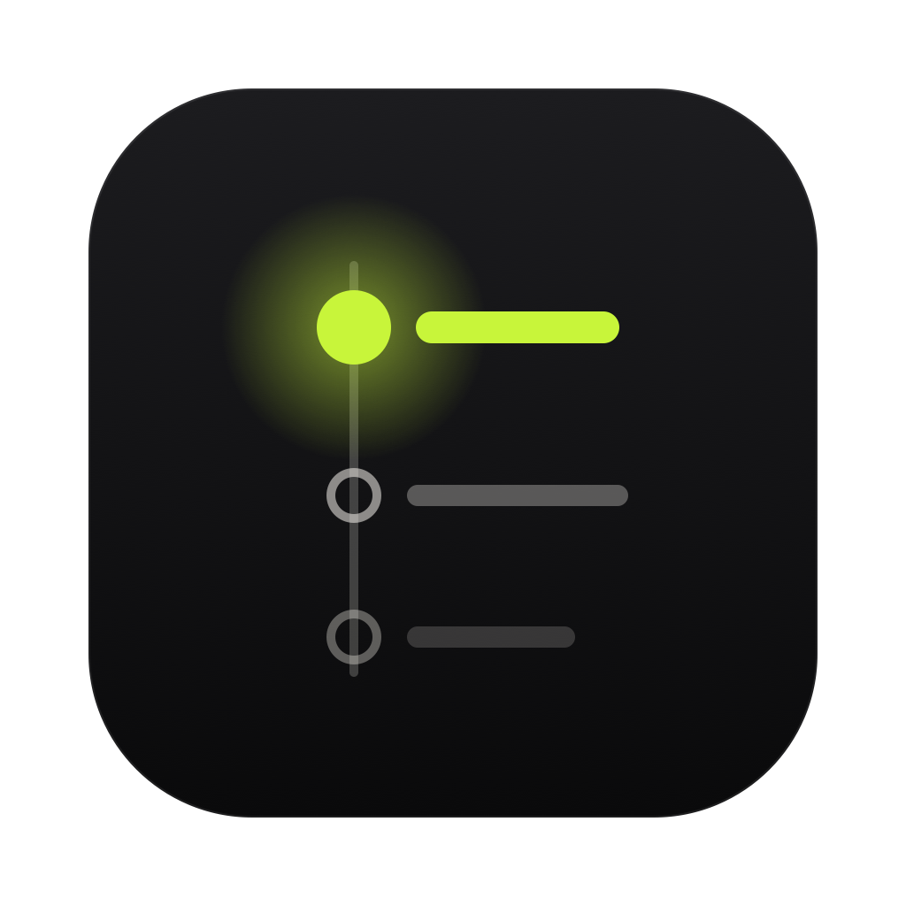
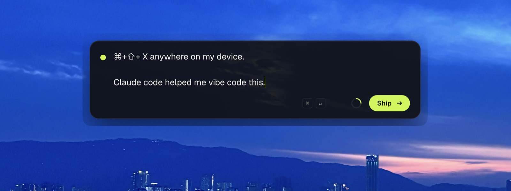
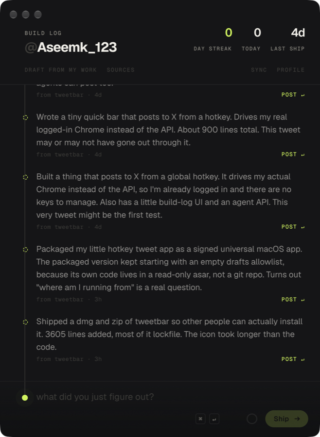

<div align="center">



# tweetbar

**Post to X from anywhere on your Mac with one hotkey. No paid API.**

⌘⇧X → type → ⌘↵ → shipped.

[**Download for macOS**](https://github.com/okarin1511/tweetbar/releases/latest) · Apple Silicon + Intel

</div>

<p align="center"></p>

## Why

Building in public dies in the friction: open X, get pulled into the feed, forget what you were going to say. The X API that would fix this is paid.

tweetbar skips both. It drives the **Google Chrome you're already signed in to**, so there's no API key, no OAuth app, and no password stored anywhere. You type in a floating bar, it posts through your real session, and you never see the timeline.

## What it does

- **Quick bar.** ⌘⇧X from any app opens a Spotlight-style composer. ⌘↵ posts, and the bar disappears.
- **Build log.** The main window shows only *your* tweets as a timeline, with your day streak, today's count, and time since your last ship.
- **Drafts from your work.** It reads new commits in the repos you choose and has Claude write tweet drafts in your voice, based on your past tweets. Drafts appear as ghost entries in the log. Press ↵ to post, `e` to edit, `x` to dismiss. Nothing posts without you.
- **Agent API.** A local HTTP endpoint lets scripts and coding agents read your tweets, queue drafts, or post.

<p align="center"></p>

## Install

1. Download the `.dmg` from [Releases](https://github.com/okarin1511/tweetbar/releases/latest) and drag **tweetbar** into Applications.
2. The app isn't notarized by Apple yet, so the first launch is blocked. Run this once:
   ```sh
   xattr -dr com.apple.quarantine /Applications/tweetbar.app
   ```
   Or try to open it, then go to **System Settings → Privacy & Security** and click **Open Anyway**.
3. In Chrome, in the profile that's signed in to X: **View → Developer → Allow JavaScript from Apple Events**. This is a per-profile setting.
4. Open tweetbar and click **Allow** when macOS asks whether it can control Google Chrome.
5. Pick the Chrome window that's signed in to X. tweetbar keeps one background tab in that window and reuses it.

## Drafts from your work

- Click **sources** to add the git repos you want drafts from. The list starts empty.
- tweetbar checks for new commits hourly. **draft from my work** runs a pass on demand.
- Drafts come from **your** commits (matched by your git `user.email`) and are written by the [Claude Code](https://claude.com/claude-code) CLI. You need `claude` installed and logged in; it uses your Claude login, not an API key.
- You get at most one nudge a day, and only if you haven't posted yet.

> [!WARNING]
> Commit messages are sent to Claude, and the drafts are meant to be posted publicly. Only add personal or open-source repos, never your employer's.

## Agent API

tweetbar listens on `127.0.0.1:4777`. Requests from web pages (anything with an `Origin` header) are rejected.

```sh
# your recent tweets
curl localhost:4777/tweets

# add a draft for you to approve in the app
curl -XPOST localhost:4777/draft -H 'Content-Type: application/json' \
  -d '{"text":"shipped dark mode","source":"my-agent"}'

# post immediately
curl -XPOST localhost:4777/tweet -H 'Content-Type: application/json' \
  -d '{"text":"hello from a script"}'
```

## How it works

```
 quick bar / main window ──IPC──▶ Electron main ──osascript──▶ Google Chrome (your profile)
                                        │                         └─ one background x.com tab
                       127.0.0.1:4777 ──┘                            paste → click Post → verify
```

- **Posting.** AppleScript runs JavaScript in a tab of the window you picked. It pastes your text into X's composer, clicks Post, and waits for the editor to clear. If X shows an error toast, tweetbar reports it.
- **Reading.** Your profile page is read the same way; only tweets authored by you are kept.
- **Why not an embedded browser?** Google sign-in refuses to run inside embedded browsers, and macOS blocks other apps from reading Chrome's cookies. Driving real Chrome sidesteps both.
- **Why a tab and not a window?** Chrome's AppleScript can't choose which profile a new window opens in, so tweetbar adds a tab to a window you've already picked.

All state lives in `~/Library/Application Support/tweetbar/`.

## Limits

- macOS and Google Chrome only.
- It works through X's web UI, so a redesign of x.com can break it until the selectors are updated.
- Text-only posts for now.

## Development

```sh
npm install
npm start       # run from source
npm run dist    # build dist/tweetbar-<version>-universal.dmg and .zip
```

The whole app is four files: `main.js` (Chrome control, posting, local API), `drafts.js` (commit reading and Claude drafting), `preload.js`, and `index.html` (the UI).

## License

[MIT](LICENSE)
